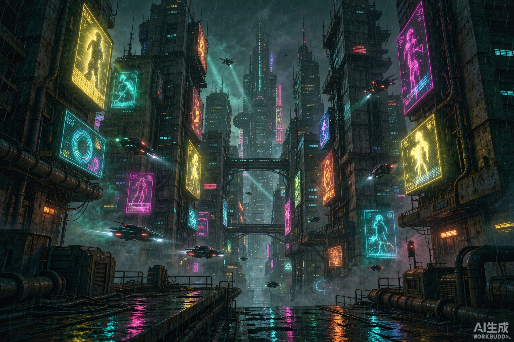

<div align="center">



<br>

# 瑞哥 . 夜之城个人终端

**NIGHT CITY PERSONAL TERMINAL**

多页面静态站 · 一屏锁定（无滚动条）· 零框架 · 零运行时依赖 · 6 段超梦回放 · 20 MiB

<sub>WAKE UP, SAMURAI. 我们有一座城市要烧。</sub>

<br>

[线上终端](https://cyberpunk-terminal-20282.app.workbuddy.host/?sharecode=GWQKPIXTQB) ｜ [GitHub Pages](https://johnnysilverhandv.github.io/cyberpunk-homepage/)

</div>

---

> 🖥️ **线上终端（国内直连）**：<https://cyberpunk-terminal-20282.app.workbuddy.host/?sharecode=GWQKPIXTQB>
>
> 🌐 **GitHub Pages**：<https://johnnysilverhandv.github.io/cyberpunk-homepage/>

## 这是什么

一个赛博朋克 2077 风格的个人主页：**每个页面在桌面端都是一屏展示完毕——页面级滚动条彻底关闭**。首页只保留状态面板（首图、打字机、统计）+ 入口矩阵，跑马灯新闻贴在导航正下方；属性、义体、专长各占独立的一屏舱室（拆分避免单页拥挤），超梦档案、语录/终端各自一屏，点击入口卡片或导航直达。另接入了独立部署的**项目控制台**（导航栏与入口卡片均可跳转）。

页面不是"套模板加霓虹"，而是把 CP2077 的界面语言拆成可复用的部件：RGB 色差故障字、CRT 扫描带、会跳动的胶片噪点、鼠标视差首图、全息投影播放器。全部手写，没有一张 UI 贴图。

## 一屏锁定（ONE-SCREEN）

桌面端 `body` 是 100% 高的 flex 容器、`overflow:hidden`，`main` 用 flex 自动把「内容区 + 薄页脚」填满剩余视口——任何常见视口（1920×1080 / 1600×900 / 1366×768 / 1280×720 均实测）都不溢出、不少页脚。字号与间距全部 `clamp()` 随视口缩放；首页入口卡与超梦元信息在矮视口自动降级隐藏，手机（≤760px 宽）回退为常规可滚动布局，保证可用性。

## 源码仓库

| 平台 | 地址 |
|---|---|
| GitHub | https://github.com/JohnnySilverhandV/cyberpunk-homepage |
| Gitee（国内镜像） | https://gitee.com/johnny-silver-hand123/cyberpunk-homepage |

## 页面结构

| 页面 | 内容 |
|---|---|
| `index.html` | 开机自检、视差首图、打字机、统计数字、跑马灯（导航正下方）、入口矩阵（6 卡）、项目控制台入口 |
| `attributes.html` | 五维属性面板（能力条进视口才填充 + 下属技能） |
| `cyberware.html` | 义体负载：扫描图 + 6 件义体（点击看诊断弹窗） |
| `perks.html` | 三条专长路线与解锁进度 |
| `braindance.html` | 六篇超梦档案，每篇带一段「接入回放」全息视频（18.7 MB 视频只在这一页加载） |
| `terminal.html` | 脑内电台语录墙 + 可输入命令的假终端：`help` / `whoami` / `contact` / `console` / `clear`，彩蛋 `burn` |

## 交互细节

- **开机自检**：`WAKE UP, 瑞哥_` 逐行点亮，三种出口（走完 / 点击跳过 / 3.4s 兜底），`finish()` 幂等
- **超梦回放**：点击「接入回放」弹出全息投影，原生 `<video>` 自动播放，播完触发 1.5 秒「结束投影」——幕布纵向塌缩成一条光带、亮度反向飙升、`SIGNAL LOST`，随后自动断开
- **打字机**：打字随机 55~115ms、删除固定 22ms、打完停 2.4s，节奏不均匀才像人
- **滚动驱动**：IntersectionObserver 双阈值（显现 .15 / 计数 .5），触发后 `unobserve`，不重播
- **跑马灯**：内容复制一份，位移恰好 `-50%`，无缝且与字体加载无关
- **终端彩蛋**：`burn` 让全站进入 4 秒烧城状态（切一个 body class，不改布局）

## 目录结构

```
cyberpunk-homepage/            ← 仓库根 = 站点根
├── README.md
├── LICENSE
├── index.html                 # 首页产物（约 9 KB，原来 66 KB）
├── attributes.html            # 属性面板
├── cyberware.html             # 义体负载
├── perks.html                 # 专长树
├── braindance.html            # 超梦档案 + 播放器
├── terminal.html              # 语录 + 终端
├── src/
│   ├── index.source.html      # 可读源码，改这里再构建
│   ├── attributes.source.html
│   ├── cyberware.source.html
│   ├── perks.source.html
│   ├── braindance.source.html
│   └── terminal.source.html
└── assets/
    ├── style.css              # 全站共享样式（跨页面缓存）
    ├── config.js              # 全站共享配置（文案/数据/控制台地址）
    ├── common.js              # 共享行为：滚动显现/计数/光晕/菜单
    ├── bd-quickhack.mp4   # 4.1 MB  快速黑客
    ├── bd-cyberware.mp4   # 3.1 MB  义体改造
    ├── bd-frontend.mp4    # 6.0 MB  前端工程
    ├── bd-badlands.mp4    # 3.1 MB  恶土见闻
    ├── bd-tower.mp4       # 2.1 MB  高塔晚风
    ├── bd-afterlife.mp4   # 2.1 MB  来世酒吧
    ├── hero-city.jpg      # 915 KB  视差首图
    ├── portrait.jpg       # 209 KB  肖像
    ├── cyberware-arm.jpg  # 419 KB  义体
    └── favicon.svg        # 247 B
```

> **改哪一份**：改文案、换视频请改 `src/*.source.html` 与 `assets/config.js`，再跑构建。
> 直接改产物也能立刻见效，但下次从源码构建时会被无声覆盖。

## 快速开始

零依赖，不需要 `npm install`：

```bash
# 方式一：直接双击 index.html（file:// 下视频探测会自动放行）
open index.html

# 方式二：起个静态服务（推荐，更接近线上）
python3 -m http.server 8000
# 浏览器打开 http://localhost:8000
```

> 本地用 `python3 -m http.server` 时**不要用它测视频 seek**：该服务器不支持 Range 请求，跳转会从头开始播。要验证「播完特效」，把 `playbackRate` 调到 8 倍跑完全程。

## 构建

六个页面共用一份源码构建命令（产物压缩后体积约 −17%）：

```bash
for p in index attributes cyberware perks braindance terminal; do
  npx html-minifier-terser \
    --collapse-whitespace --remove-comments \
    --minify-css true --minify-js true \
    --remove-attribute-quotes --remove-redundant-attributes \
    src/$p.source.html -o $p.html
done
```

## 性能账本

| 项目 | 之前 | 之后 | 降幅 |
|---|---|---|---|
| 六段超梦视频 | 90.0 MiB | 18.7 MiB | **−79.2%** |
| 三张图片 | 9.3 MB | 1.5 MB | −84% |
| 首页 HTML | 77.6 KB | **8.7 KB** | −89%（内容拆入子页） |
| 全站 | ~99 MiB | **20 MiB** | −80% |

视频占总体积 95%，所以优化火力全押在这里：H.264 `-crf 22 -preset medium -pix_fmt yuv420p -movflags +faststart`，1080p 先降到 720p；图片一律 PNG→JPEG 并先限最长边（`sips -Z`），比继续降质量省得多。**压缩率取决于素材复杂度，不取决于参数。**

打开速度三板斧：① 首页只留首屏，视频与重内容全部按需进子页；② 样式抽成 `assets/style.css` 一份，六个页面共享浏览器缓存；③ Google Fonts 样式表非阻塞加载（`media="print"` + `onload` 切换），断网/被墙时立即用系统字体渲染，不白等。

## 技术要点速览

| 问题 | 做法 |
|---|---|
| 数字故障字 | 两个伪元素青/红双通道 + `clip-path: inset()` 切片，`steps(1)` 跳变，0%~88% 完全静止 |
| 结束投影 | `transform-origin: bottom` + `scaleY → 0`，同时 `brightness` 反向飙升到 6.5，`cubic-bezier(.5,0,.75,0)` |
| 自动播放被拒 | `play()` 必须在 click 的同步调用栈内，返回的 Promise 要 `.catch()` |
| 判断播完 | 只信 `ended` 事件，绝不用时长推算；关闭时 `innerHTML=''` 释放解码器，回调首行 `if(!vid) return` |
| 视频探测 | 黑名单而非白名单：只有 404/410 才锁住「接入回放」，405/异常/`file:` 一律放行 |
| 视差首图 | `scale(1.06)` 做 overscan，覆盖率必须大于最大位移，否则边角露白 |

## 版本记录

### v1.3.0 — 2026-11-06

密度优化：属性·义体·专长从一页拆为三页，每页独占一屏，彻底解决单页拥挤。

- 新增 `attributes.html`（属性面板）与 `perks.html`（专长树），`cyberware.html` 只留义体负载（扫描图 + 6 卡撑满）
- 拆分后每页内容密度减半，属性卡放大（数值大字 + 技能列聚底）、专长行均匀分布，矮屏降级规则随之大幅放宽
- 首页入口矩阵扩为 6 卡（属性/义体/专长/超梦/终端/控制台），导航同步为 6 项
- 四视口 × 六页面 = 24 项布局审计全绿（无溢出 + 页脚精确铺满）
- 线上入口统一为托管地址 `cyberpunk-terminal-20282`（带 sharecode），旧域名 `cyberpunk-terminal` 停用

### v1.2.0 — 2026-11-06

一屏锁定改造：桌面端全站禁止页面滚动，每页一屏展示完毕。

- `body` 100% flex 容器 + `overflow:hidden`，`main` flex 自动分配，页脚改为 36px 薄条（公司条 + NCPD + 状态合并一行）
- 首页：hero 弹性占满 + 入口矩阵压成底部卡带；属性页：页头/属性条带/义体网格/专长条带纵向一屏；超梦页 3×2 网格；终端页左右双栏（语录 | 终端）
- 字号间距全面 `clamp()` 随视口缩放；矮屏（≤860/≤780px 高）两级降级隐藏次要信息；手机（≤760px 宽）回退可滚动
- 修复 margin 折叠导致的隐形 64px 偏移（body 改 flex 容器根治）
- 四视口 × 四页面 = 16 项布局审计全绿（无溢出 + 页脚精确铺满）

### v1.1.0 — 2026-11-06

首页轻量化：单文件全量站拆为「首页 + 三个子页面」。

- 首页只保留首屏（开机自检、视差首图、打字机、统计、跑马灯置顶）+ 入口矩阵，HTML 从 66 KB 降到 8.7 KB
- 属性·义体·专长 / 超梦档案 / 语录·终端 拆入 `cyberware.html` / `braindance.html` / `terminal.html`，18.7 MB 视频只在超梦页加载
- 样式抽为共享 `assets/style.css`，配置抽为 `assets/config.js`，行为抽为 `assets/common.js`，跨页面缓存
- Google Fonts 非阻塞加载，弱网/断网首屏不白等
- 接入项目控制台：导航栏与首页入口卡片直达（独立托管应用）

### v1.0.0 — 2026-11-04

首个版本，双远端（GitHub + Gitee）同步发布。

- 单文件赛博朋克主页：七个区块、开机自检、打字机、滚动驱动、无缝跑马灯、终端命令彩蛋
- 六段超梦回放：原生 `<video>` + 自绘 HUD，真实 `ended` 驱动结束投影特效
- 媒体压缩：全站 99 MiB → 20 MiB（视频 −79.2%）
- 源码/产物分离 + 构建脚本，线上产物与仓库字节一致

## 声明

个人主页项目，与 CD PROJEKT RED 无关；《赛博朋克 2077》相关名词仅作致敬。页面无第三方运行时依赖，不含统计脚本。
